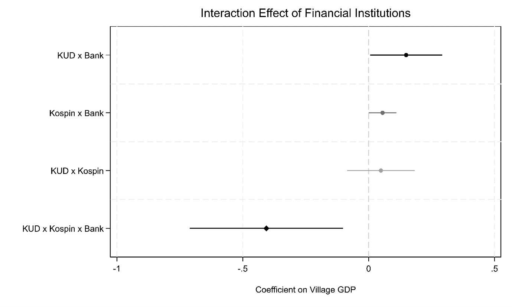

[← Back to Research](../../research.qmd)

## The question

Cooperatives are a pillar of rural finance in Indonesia, but they come in different forms. Village Cooperative Units (KUD) are the traditional, village-based model. Savings and Loans Cooperatives (Kospin) focus on member savings and credit. Do they support village economies equally well, and what happens when they operate alongside formal banks?

## Data and method

Villages rarely have their own GDP figures, so the study measures economic activity from space. It converts nighttime-light satellite data into village-level GDP estimates, calibrated against official figures, and combines these with village-level data on which institutions are present. Quasi-experimental methods then compare villages with and without each cooperative type, alone and in combination with banks.

## What the study finds

- **Kospin villages do better.** They are consistently associated with higher local economic activity.
- **KUDs on their own show no clear difference.** Villages with a KUD operating in isolation are not statistically different.
- **KUDs paired with formal banks do better.** Where the two coexist, outcomes are more favorable.
- **Adding more stops helping.** When KUDs, Kospin and banks are all present, the marginal gains weaken, which points to possible overcrowding (Figure 1).

## Why it matters

The results challenge one-size-fits-all policy. What a cooperative adds depends on which institutions already serve the village, and too many overlapping providers may crowd out gains. This matters now that Indonesia is rolling out its "Koperasi Merah Putih" flagship initiative: the evidence points toward a flexible, context-sensitive cooperative ecosystem rather than a uniform template. The lesson on institutional complementarity also extends to inclusive-finance efforts across developing Asia.

[Read the full article →](https://www.emerald.com/ijse/article-abstract/doi/10.1108/IJSE-11-2025-1107/1386106/Too-crowded-to-grow-Luminosity-based-evidence-on?redirectedFrom=fulltext)