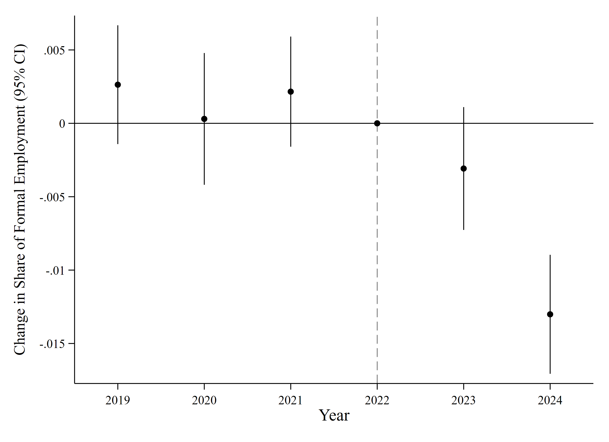
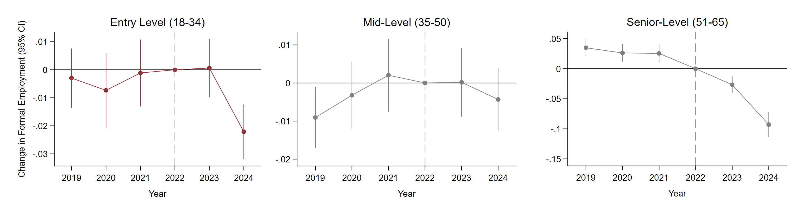

[← Back to Research](../../research.qmd)

## The question

Most debates about generative AI ask whether it will destroy jobs. But in developing economies like Indonesia, where formal and informal employment offer very different levels of security and protection, another question matters: does AI change not just how many people work, but the kinds of jobs they hold? Following ChatGPT's public release in late 2022, did workers in more AI-exposed groups experience a greater decline in formal employment?

## Data and method

Indonesia's national labor force survey (Sakernas, 2019–2024) is rich but does not follow the same workers over time, which rules out the standard panel approach. Given this limitation, we take a different route:

- **A demographic pseudo-panel**, which tracks groups of similar workers (by cohort and background) instead of individuals.
- **A GenAI-exposure measure adapted to Indonesia**, so that existing occupational measures fit occupation–industry cells in the local labor market.
- **A continuous-treatment difference-in-differences design**, which treats ChatGPT's release as a common shock and compares groups with more versus less baseline exposure, before and after.

## What we find

**Total employment barely moved.** We detect no differential change in overall employment between more- and less-exposed groups.

**The formal share did.** A one-standard-deviation increase in baseline exposure lowers the formal-employment share by 0.9–1.3 percentage points. Figure 1 shows why we trust this: before late 2022 the groups move in parallel, and afterwards the formal share falls in the more exposed group. Event-study and placebo tests support the result.

**The young bear most of it.** The decline is concentrated among entry-level cohorts and selected service industries (Figure 2). Over the same period, freelance employment among Gen Z workers (aged 18–27) rose significantly by 2024, which suggests a shift in how young workers enter the labor market.

## Why it matters

Headline employment numbers may remain stable, but the adjustment can occur in *employment formality*: younger workers face weaker pathways into regular jobs, while freelance and platform-based work becomes an alternative. Policy should therefore strengthen early-career pathways through targeted internships in highly exposed sectors and extend basic labor protections, including occupational safety and social security, beyond ride-hailing to a broader range of informal and platform workers. The focus should be not only on developing AI-related skills, but also on ensuring that technological change does not come at the expense of access to formal employment and worker protection.

[Read the full paper →](https://papers.ssrn.com/sol3/papers.cfm?abstract_id=7108818)