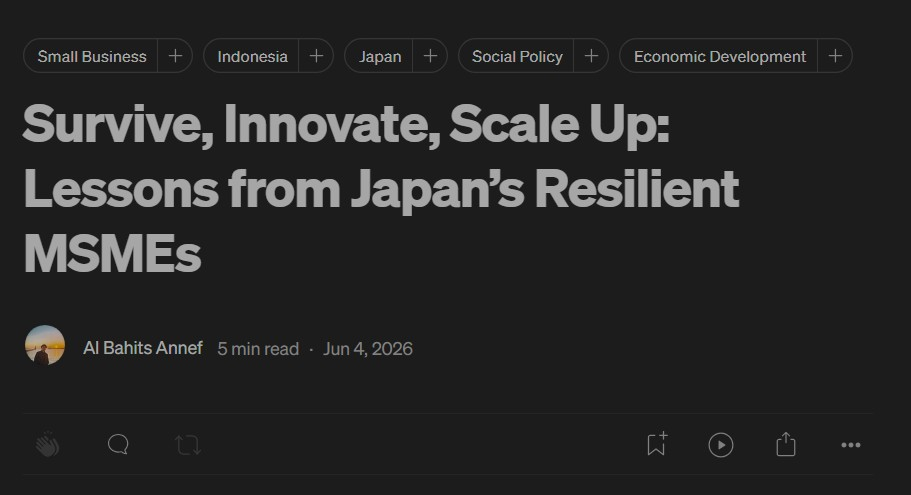
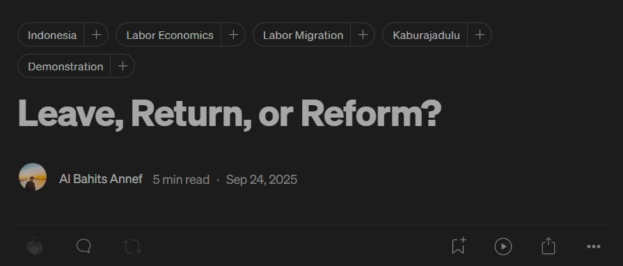
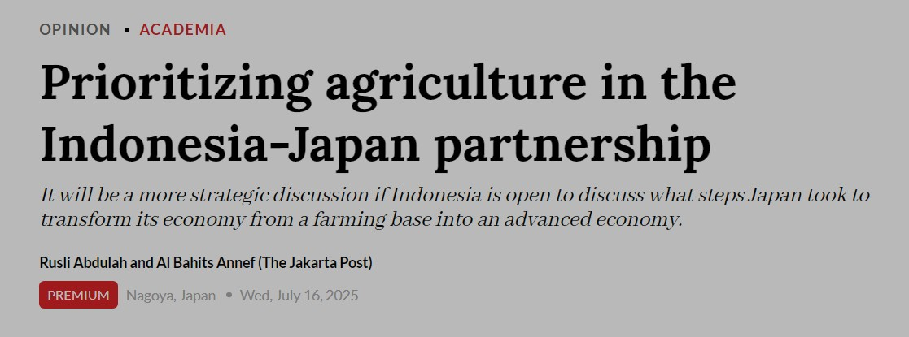

```{=html}
<div class="jump">
  <a href="#english">English</a>
  <a href="#indonesia">Bahasa Indonesia</a>
</div>
```

## English {#english}

```{=html}
<div class="pub">
  <div class="pub-year wide">Jun 2026</div>
  <a class="pub-thumb" href="https://medium.com/@arubahitsu21/survive-innovate-scale-up-lessons-from-japans-resilient-msmes-ffe055e133d5" target="_blank" rel="noopener">
  
  </a>
  <div class="pub-body">
    <div class="pub-title"><a href="https://medium.com/@arubahitsu21/survive-innovate-scale-up-lessons-from-japans-resilient-msmes-ffe055e133d5" target="_blank" rel="noopener">Survive, Innovate and Scale Up: Lessons from Japan's Resilient MSMEs ↗</a></div>
    <div class="pub-authors"><strong>Al Bahits Annef</strong></div>
    <div class="pub-venue"><span class="outlet">Medium</span></div>
  </div>
</div>

<div class="pub">
  <div class="pub-year wide">Sep 2025</div>
  <a class="pub-thumb" href="https://medium.com/@arubahitsu21/leave-return-or-reform-f4b93622a5fa" target="_blank" rel="noopener">
    
  </a>
  <div class="pub-body">
    <div class="pub-title"><a href="https://medium.com/@arubahitsu21/leave-return-or-reform-f4b93622a5fa" target="_blank" rel="noopener">Leave, Return or Reform? ↗</a></div>
    <div class="pub-authors"><strong>Al Bahits Annef</strong></div>
    <div class="pub-venue"><span class="outlet">Medium</span></div>
  </div>
</div>

<div class="pub">
  <div class="pub-year wide">Jul 2025</div>
  <a class="pub-thumb" href="https://www.thejakartapost.com/opinion/2025/07/16/prioritizing-agriculture-in-the-indonesia-japan-partnership" target="_blank" rel="noopener">
    
  </a>
  <div class="pub-body">
    <div class="pub-title"><a href="https://www.thejakartapost.com/opinion/2025/07/16/prioritizing-agriculture-in-the-indonesia-japan-partnership" target="_blank" rel="noopener">Prioritizing Agriculture in the Indonesia-Japan Partnership ↗</a></div>
    <div class="pub-authors">Rusli Abdulah, <strong>Al Bahits Annef</strong></div>
    <div class="pub-venue"><span class="outlet">The Jakarta Post</span></div>
  </div>
</div>
```

## Bahasa Indonesia {#indonesia}

```{=html}
<div class="pub">
  <div class="pub-year wide">Jul 2025</div>
  <a class="pub-thumb" href="https://insight.kontan.co.id/news/refleksi-ekonomi-dari-potong-rambut-di-jepang" target="_blank" rel="noopener">
    
  </a>
  <div class="pub-body">
    <div class="pub-title"><a href="https://insight.kontan.co.id/news/refleksi-ekonomi-dari-potong-rambut-di-jepang" target="_blank" rel="noopener">Refleksi Ekonomi dari Potong Rambut di Jepang ↗</a></div>
    <div class="pub-authors"><strong>Al Bahits Annef</strong></div>
    <div class="pub-venue"><span class="outlet">Kontan</span></div>
  </div>
</div>
```