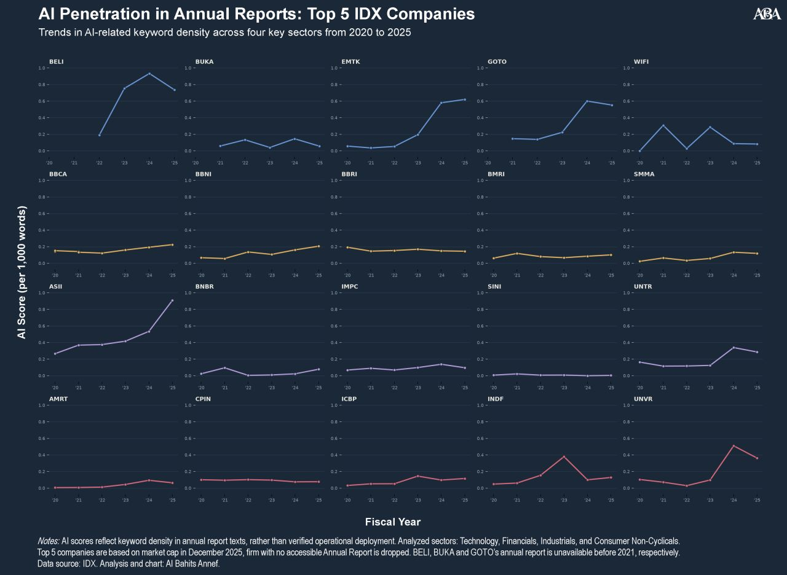
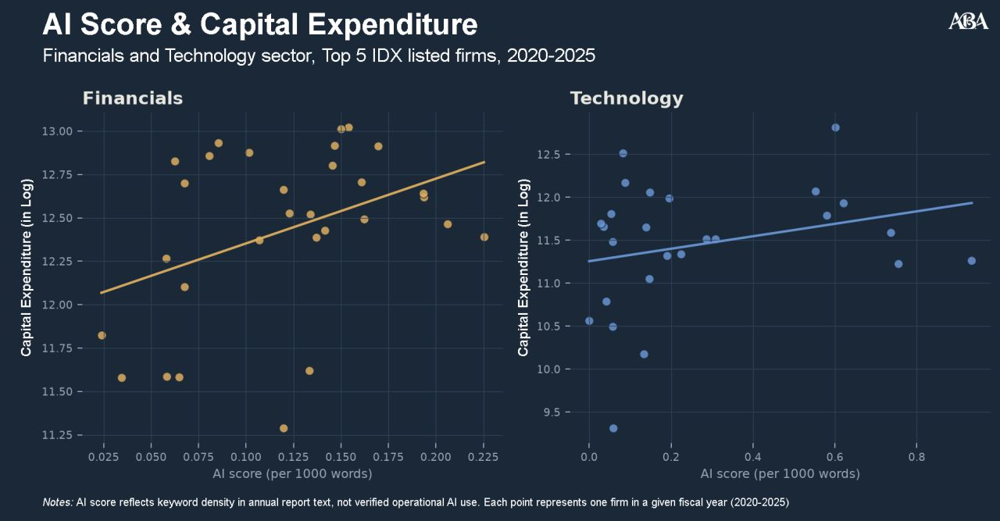

[← Back to Projects](../../projects.qmd)

## The question

We hear a lot about AI transforming the corporate landscape, but who is actually talking about it, and does size matter?

## Data and method

I scraped and text-mined the annual reports (2020–2025) of Indonesia's largest listed companies across Financials, Technology, Industrials and Consumer sectors. "AI penetration" measures how much a firm talks about AI in its own disclosures, using keyword density.

- **Tools:** Python, with pdfplumber for PDF parsing and pandas for the data work. Built with AI assistance (Claude).

## What the data shows

**1. The AI conversation is still concentrated in Tech.** Blibli (BELI) and GoTo Group (GOTO) naturally lead. Beyond them, Astra International (ASII) shows an isolated but rising AI conversation in the Industrial sector. Financials follow the same upward trend, though modestly, led by BCA (BBCA), BNI (BBNI) and Sinar Mas Multiartha (SMMA).

**2. AI rhetoric is beginning to track capital allocation.** Within Financials and Tech, the firms with the largest capital expenditure (CapEx) are also those that put the most emphasis on AI in their reporting, a positive correlation.

## What it does and does not tell us

Keyword density captures what firms *say*, not what they deploy, and the CapEx link is descriptive, not causal. Corporate reporting is the surface layer. The real question is how it translates into operational deployment and productivity gains.

Do these reporting trends match what you see in the market, or is it just another buzzword? [Join the discussion on LinkedIn →](https://lnkd.in/p/gGVccPCS)