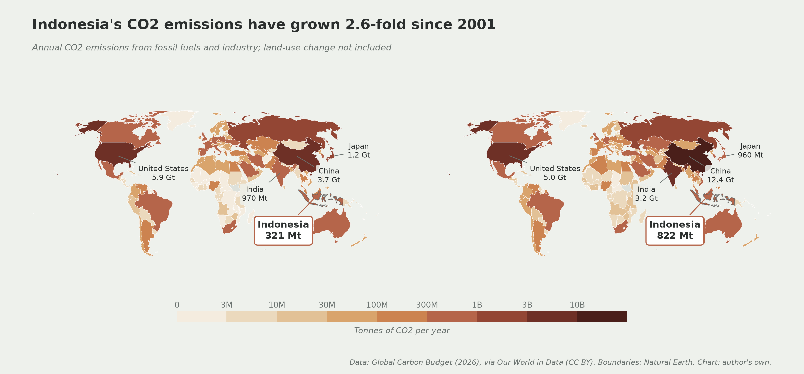
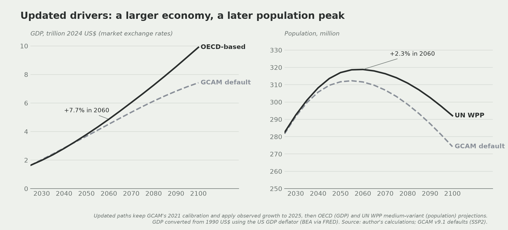
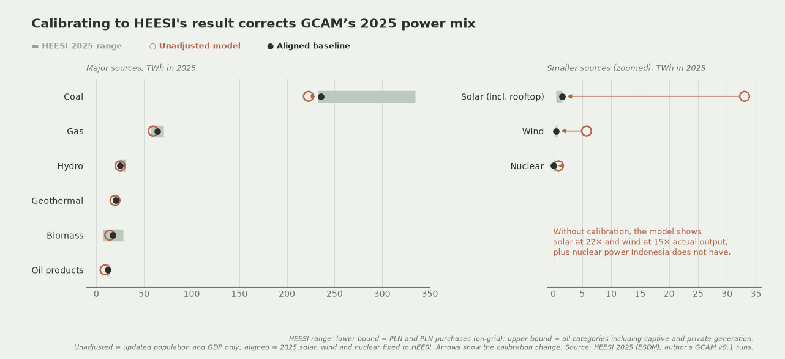
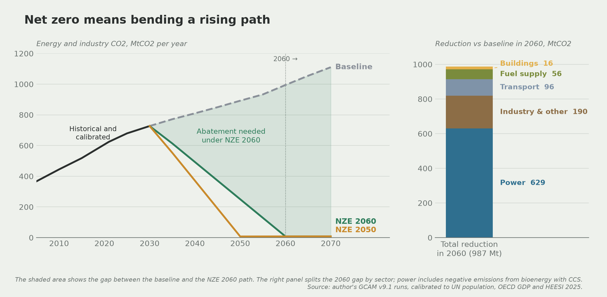
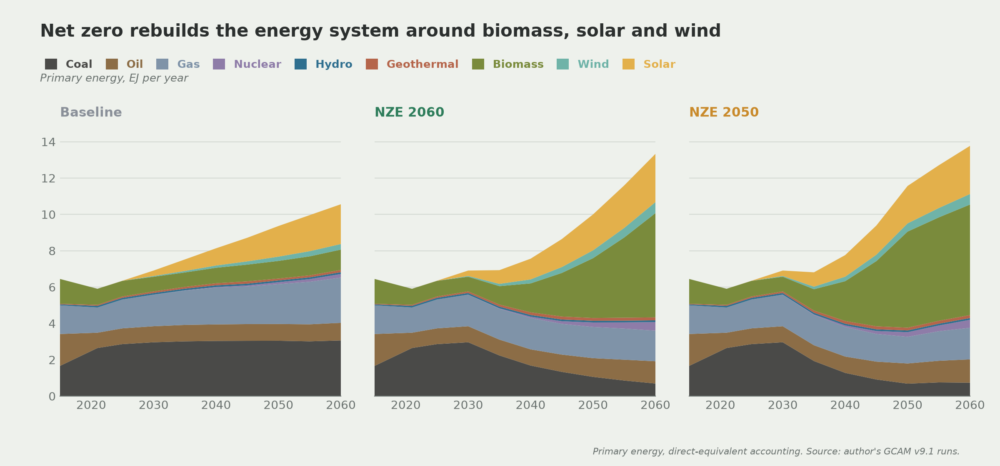
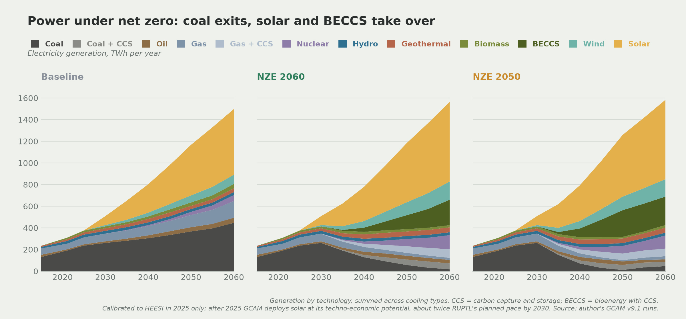
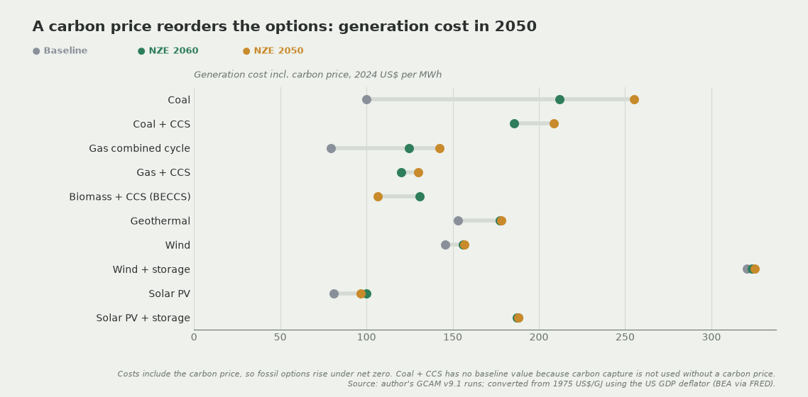
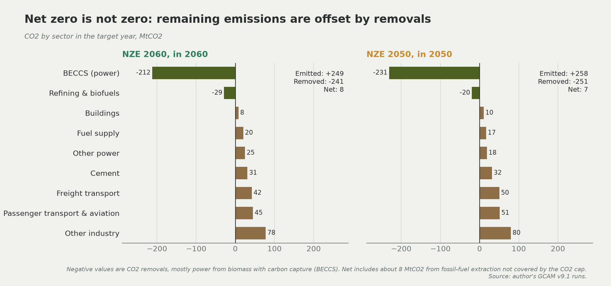
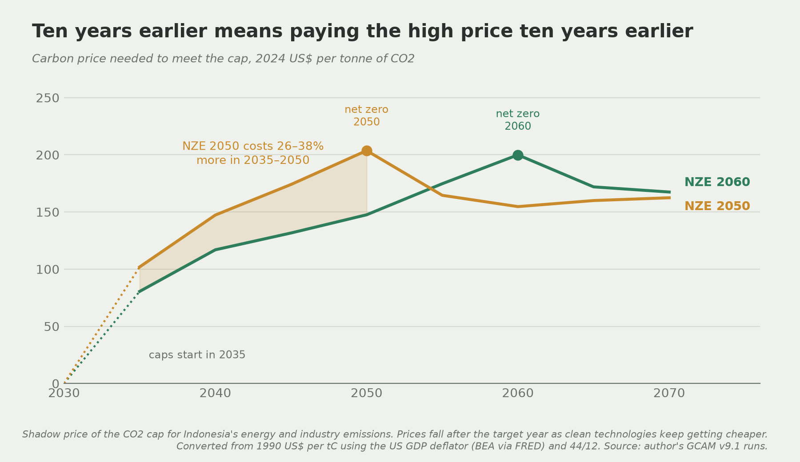
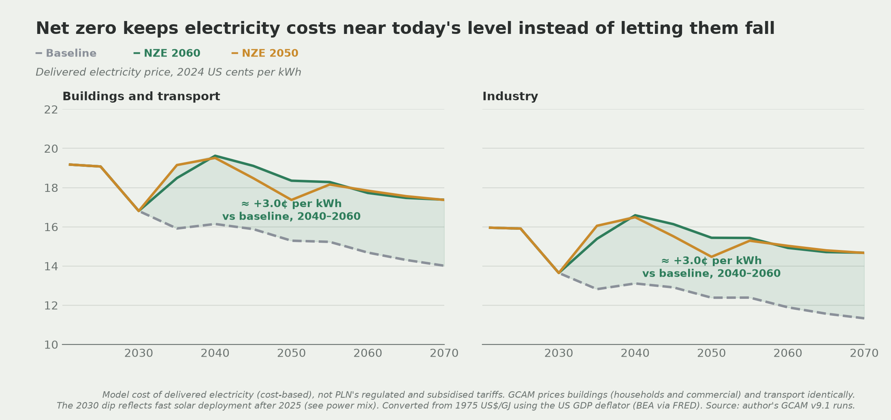

*Global pressure to cut emissions calls for collective action. Where do Indonesia's population, economy and energy system stand against its net-zero target, and what would it take to get there ten years sooner?*

::: {.callout-tip appearance="simple" icon=false}
## At a glance

- In the model's baseline, without new policy, Indonesia's energy and industry CO~2~ keeps rising, by almost half (about 46%) between 2025 and 2060.
- Net zero is reachable in the model under both targets, but "net" carries weight: about 250 MtCO~2~ is still emitted in the target year, offset almost entirely by bioenergy with carbon capture (BECCS).
- Reaching net zero in 2050 instead of 2060 requires carbon prices 26–38% higher through 2035–2050; both paths peak near US\$200 per tonne of CO~2~.
- For electricity users, net zero adds about 3 US cents per kWh compared with the baseline in 2040–2060: a price decrease foregone rather than a price shock.
:::

## Why this matters

As COP31 convenes in Antalya, Türkiye (9–20 November 2026), the gap between pledges and the Paris Agreement's goal of holding warming well below 2°C remains wide. UNEP's [Emissions Gap Report 2026](https://unep.org/en/publications/report/emissions-gap-report-2026) projects 2.8°C of warming this century under current policies, and 2.6°C even if every country delivers its national pledge (NDC).

Indonesia is among the world's ten largest greenhouse gas emitters. Its CO~2~ emissions from fossil fuels and industry reached about 822 MtCO~2~ in 2025, 2.6 times their 2001 level (@fig-co2map).

The Indonesian Government's official net-zero target is 2060 or sooner, and President Prabowo has said that 2050 is within reach.

This exercise asks what each target demands of Indonesia's energy system, and what the ten years between them cost.

{#fig-co2map fig-alt="Two world maps of annual CO2 emissions in 2001 and 2025. Indonesia rises from 321 Mt to 822 Mt; China, the United States, India and Japan are labelled for comparison."}

## Approach

The projections use the Global Change Analysis Model or GCAM v9.1. It was developed by the Joint Global Change Research Institute (Pacific Northwest National Laboratory). GCAM is an integrated assessment model, where it links the economy, energy, land, water and climate in 32 world regions, Indonesia among them, and in each five-year period it finds the prices that balance supply and demand across all markets at once.

As in the real world, a change in one element ripples through the others. A carbon price, for example, changes which power plants are built or how much industries pay for electricity generation. This makes GCAM well suited to asking what a national target implies for the whole system rather than for one sector.

The exercise has three steps:

1. **Update the drivers.** Replace GCAM's default population and GDP paths for Indonesia (a generic middle-of-the-road scenario, SSP2) with the latest UN and OECD projections.
2. **Validate and calibrate.** Compare GCAM's 2025 electricity generation by source with the Handbook of Energy and Economic Statistics of Indonesia (HEESI) 2025, then correct the 2025 power mix where the model diverges.
3. **Add the net-zero targets.** Cap Indonesia's energy and industry CO~2~ so that it follows the baseline to a 2030 peak, falls in a straight line to zero in 2050 or 2060, and stays at zero afterwards. GCAM solves for the carbon price that meets each cap.

## Building a baseline that reflects Indonesia

### Updating population and growth

Population and income drive everything else in GCAM: how much energy households and industry demand, and therefore how much has to be decarbonised. GCAM's default pathway is shared across all regions and predates the latest projections. For Indonesia it understates population throughout the century, and understates economic growth after the mid-2040s. If I built the baseline on these drivers, it would understate the possible outcomes.

To solve this, I keep GCAM's calibrated 2021 values, apply observed growth to 2025, and follow the UN medium variant and OECD long-term projections thereafter. Replacing the 2021 values themselves would break the consistency of GCAM's calibration, in which energy data and demand parameters are fitted jointly with 2021 population and GDP. The updates enter the model as a small add-on file, and a check confirms that GCAM's output reproduces the inputs exactly.

```{.xml filename="socioeconomics_idn.xml"}
<!-- overrides 2025-2100 for Indonesia -->
<region name="Indonesia">
  <demographics>
    <populationMiniCAM year="2025"><totalPop>282410</totalPop></populationMiniCAM>
    ...
  </demographics>
  <nationalAccountContainer>
    <nationalAccount year="2025"><GDP>771295</GDP></nationalAccount>
    ...
  </nationalAccountContainer>
</region>
```

```{.xml filename="configuration file (inside ScenarioComponents)"}
<Value name="socio_idn">D:/GCAM/idn-runs/xml/socioeconomics_idn.xml</Value>
```

{#fig-drivers fig-alt="Two line charts. OECD-based GDP is 2.4 percent below GCAM's default in 2030 and 7.7 percent above it in 2060. UN-based population is 2.3 percent higher in 2060 and peaks at about 319 million."}

The near-term economy is slightly smaller than the GCAM default projected, which matters for the late 2020s and early 2030s, the period covered by the national electricity plan (RUPTL 2025–2034). From the mid-2040s it is larger, so reaching net zero in 2060 means decarbonising a bigger economy than the default model implies.

### Calibrating the 2025 power mix

Updating population and GDP sets how much electricity Indonesia uses, not which technologies supply it. GCAM's 2025 total of 390 TWh fell within HEESI's range, but the problem is that the power mix did not.

The unadjusted model generated 22 times more solar and 15 times more wind than HEESI reports. Worse, it included nuclear power generation, which Indonesia does not possess at present.

One possible explanation is instructive. GCAM chooses technologies by cost, and solar is cost-competitive in its economics. Indonesia's actual deployment has been held back by barriers that are not only about cost. It covers something more dynamics, including procurement processes, local-content regulations, long-term coal contracts and even political considerations.

I fixed 2025 output for solar, wind and nuclear at HEESI values, using the same mechanism GCAM uses for hydropower, and left coal to fill the remaining demand through the model's own logic. After calibration, six of eight sources fall within HEESI's range, and solar and wind match exactly (@fig-calibration).

{#fig-calibration fig-alt="Dot plot of 2025 generation by source. Unadjusted solar is 33 TWh against 1.5 TWh in HEESI; after calibration solar, wind and nuclear match HEESI."}

HEESI is shown as a range because its 2025 edition adds 144.5 TWh of private and captive generation, much of it coal plants serving industrial estates. Part of it may overlap with PLN's purchases. GCAM's calibrated coal sits at the on-grid level, so captive coal for industry is likely under-represented. Captive coal capacity reached about 19.3 GW in 2025, according to [CREA and Global Energy Monitor](https://energyandcleanair.org/publication/31-gw-of-captive-coal-is-jeopardizing-indonesias-economic-and-emissions-goals/), driven largely by nickel processing in Central Sulawesi and North Maluku; projects in development would take it above 31 GW.

## Two pathways to net zero

Before going further: what exactly is net zero? [Oxford Net Zero](https://netzeroclimate.org/what-is-net-zero/) at the University of Oxford defines it as "a state in which the greenhouse gases going into the atmosphere are balanced by removal out of the atmosphere." As the same source puts it, "the term net zero is important because – for CO2 at least – this is the state at which global warming stops."

In the model's baseline, without new policy, emissions keep rising: from about 680 MtCO~2~ in 2025 to about 1,000 MtCO~2~ by 2060. The model's 2025 level sits about 17% below the 822 MtCO~2~ estimate above, mainly because coal plants serving industry are under-represented, so the task shown here is, if anything, understated.

Both targets bend this path from a 2030 peak of about 730 MtCO~2~. By 2060, NZE 2060 avoids 987 MtCO~2~ relative to the baseline. The power sector delivers about two-thirds of that cut, largely because bioenergy with carbon capture turns its emissions negative (@fig-headline).

Each target enters the model as one more add-on file: a CO~2~ cap for Indonesia with its own carbon market, so GCAM solves for the carbon price that holds emissions at each year's cap. The caps start in 2035, after the 2030 peak, and are set in million tonnes of carbon (MtC; multiply by 3.67 for MtCO~2~).

The NZE 2060 policy file looks like this:

```{.xml filename="idn_nze2060.xml"}
<region name="Indonesia">
  <ghgpolicy name="CO2">
    <market>Indonesia</market>
    <constraint year="2035">165.23</constraint>
    <constraint year="2040">132.19</constraint>
    <constraint year="2045">99.14</constraint>
    <constraint year="2050">66.09</constraint>
    <constraint year="2055">33.05</constraint>
    <constraint year="2060">0.00</constraint>
    ...                                   <!-- zero through 2100 -->
  </ghgpolicy>
</region>
```

```{.xml filename="configuration file (inside ScenarioComponents)"}
<Value name="nze_idn">Disk:/GCAM/idn-runs/xml/idn_nze2060.xml</Value>
```

NZE 2050 uses the same structure, with the cap reaching zero in 2050 instead.

Both targets bend this path from a 2030 peak of about 730 MtCO~2~. By 2060, NZE 2060 avoids 987 MtCO~2~ relative to the baseline. The power sector delivers about two-thirds of that cut, largely because bioenergy with carbon capture turns its emissions negative (@fig-headline).

{#fig-headline fig-alt="Line chart: history rises to about 730 MtCO2 in 2030, then the baseline climbs past 1,000 MtCO2 while both net-zero paths fall to near zero. A stacked bar splits the 2060 reduction of 987 MtCO2: power 629, industry 190, transport 96, fuel supply 56, buildings 16."}

Net zero rebuilds the energy system rather than shrinking it.

Total primary energy is higher under both targets than in the baseline by 2060, and the difference is biomass, which grows several-fold to feed bioenergy power plants with carbon capture and biofuels. Interestingly, coal and gas shrink but do not disappear completely. 

By 2060, total primary energy reaches about 13–14 EJ under the net-zero paths against about 10.6 EJ in the baseline, and biomass supply is roughly five times the baseline level (@fig-primary). This pattern actually depicts current situation where government has think about it. The biodiesel blending mandate rose to B50 as of July 2026, and PLN co-fires biomass in its coal power plants. 

To author, this is where the net-zero pathways ignite a further concern. They would demand five to six times today’s biomass supply, and the model counts that biomass as carbon-neutral. That holds only if it is grown on land that is already farmed, not on cleared forest or drained peatland. 

If expansion comes at the expense of forests, the emissions reappear as land-use change, which these pathways do not cap. This condition compounds an existing crisis as hundred-thousand hectares of forest and land burned for the past few months, mostly in Sumatera, Kalimantan and now in Papua -- often on drained peatland, with fire used to clear land as the main cause. 

Therefore, outside technical calculation, land and forest safeguards are undoubtedly not a side issue, but rather a condition for the net-zero results to hold.

{#fig-primary fig-alt="Three stacked area charts. In both net-zero scenarios, coal and gas layers thin and biomass grows to about 6 EJ by 2060, against about 1 EJ in the baseline."}

In the power sector, total generation is similar across scenarios; what changes is the source. In the baseline, coal keeps growing to about 450 TWh by 2060. Under both targets it shrinks toward a small remainder, replaced by solar and by BECCS, which exceeds 200 TWh by 2060 (@fig-power).

One caveat on how this figure should be read. The model is calibrated to 2025 only, so from 2030 GCAM deploys solar based on its **techno-economic potential**. Even in the baseline, solar reaches 80 TWh in 2030, roughly twice the pace in Indonesia's current electricity plan (RUPTL 2025–2034).

The GCAM model projects that solar is economic at scale. Whether planning and procurement allow it is a separate question, taken up below.

{#fig-power fig-alt="Three stacked area charts of generation. Baseline coal grows to about 450 TWh by 2060; under net zero coal shrinks and solar and BECCS take most of the mix."}

## What net zero relies on

A carbon price reorders the options. In 2050, coal power costs about US\$100 per MWh in the baseline but US\$210–255 under the net-zero paths. Solar remains the cheapest source in every scenario at about US\$80–100 (@fig-costs).

This result is timely. On 25 August 2026, the government [launched a programme](https://setkab.go.id/en/govt-launches-100-gwp-solar-initiative-beginning-with-14-plants-across-six-provinces/) to build 100 GWp of solar capacity within about three years, starting with 14 plants totalling 5.3 GWp. That ambition goes well beyond even the model's unconstrained baseline, which reaches roughly 30 GW of solar by 2030.

Two further results stand out. BECCS becomes cheaper the stricter the target, because a higher carbon price pays it for the CO~2~ it removes. And storage, not generation, is the expensive part of a renewable system: wind with storage costs about US\$320 per MWh, solar with storage about US\$187.

{#fig-costs fig-alt="Dot plot of generation costs in 2050. Coal rises from about 100 to 210-255 US dollars per MWh under net zero; solar PV stays cheapest at about 80-100."}

Net zero is not zero. As Oxford Net Zero puts it, "to 'go net zero' is to reduce greenhouse gas emissions and/or to ensure that any ongoing emissions are balanced by removals."

In the target year, about 250 MtCO~2~ is still emitted, mainly by industry, passenger and freight transport and cement. Almost all of it is offset by a single technology: BECCS removes 212 MtCO~2~ a year in NZE 2060 and 231 MtCO~2~ in NZE 2050 (@fig-sectors). That is comparable to the entire power sector's emissions today, and it requires biomass supply on a scale that raises direct questions about land, forests and Indonesia's forestry and land-use (FOLU) commitments.

{#fig-sectors fig-alt="Horizontal bar charts for NZE 2060 in 2060 and NZE 2050 in 2050. About 250 MtCO2 emitted is offset by about 245 MtCO2 removed, mostly BECCS in power."}

## The cost of ambition

Both targets end at roughly the same carbon price, about US\$200 per tonne of CO~2~. Interestingly, bringing the target forward by ten years does not raise the peak; it brings it forward.

Carbon prices are 26–38% higher throughout 2035–2050 under the NZE 2050 scenario (@fig-carbonprice). After each target year the price falls, as clean technologies keep getting cheaper in the model and holding zero costs less than reaching it.

{#fig-carbonprice fig-alt="Line chart of carbon prices. NZE 2050 peaks at about 204 US dollars per tonne in 2050 and NZE 2060 at about 200 in 2060; NZE 2050 is 26-38 percent higher over 2035-2050."}

For electricity users, the effect is smaller than the carbon price suggests.

Delivered electricity costs about 19 US cents per kWh in 2025 in the model. In the baseline, cheap solar and coal let it fall to about 14 cents by 2070.

Under net zero it stays near today's level, about 3 cents per kWh above the baseline over 2040–2060 (@fig-elecprice). For consumers, the cost of net zero is not a sudden price increase; it is a smaller decrease than they would otherwise have received. GCAM treats households and businesses as one group and does not account for PLN's regulated, subsidised tariffs, so these numbers show cost trends, not predicted bills.

{#fig-elecprice fig-alt="Two line charts for buildings and transport, and industry. Net-zero prices stay near today's level while the baseline falls, a gap of about 3 cents per kWh over 2040-2060."}

## Implications

1. **Delivering the electricity plan is the cheapest insurance for either target.** Indonesia's Electricity Supply Business Plan (RUPTL) 2025–2034 adds 69.5 GW of capacity, 76% of it renewables and storage. But it is back-loaded: in 2025–2029, fossil additions (12.7 GW) slightly exceed renewables (12.2 GW), and most renewable capacity arrives in 2030–2034. The GCAM model finds solar economic at scale, while the binding constraints are institutional, which the model cannot capture. Every year of delay compresses the remaining path, and the NZE 2050 results show what compression costs: 26–38% higher carbon prices across fifteen years.
2. **Net zero should not rest on a single removal technology.** Both pathways depend on more than 200 MtCO~2~ a year of BECCS, a technology unproven at that scale anywhere. A credible strategy hedges with faster cuts in industry and transport, investment in storage and grids, and a land-use plan that keeps biomass demand consistent with forest commitments.
3. **Green and development financing is imperative.** Cooperation programmes such as the World Bank's Indonesia Sustainable Least-cost Electrification program (ISLE-1, US\$500 million, focused on Maluku and Nusa Tenggara) and its successor ISLE-2 (540 MW of solar and wind) are the kind of least-cost renewable investment both pathways require, at far larger scale. Renewable generation, storage and grid integration are arguably among the most expensive components of the transition, which is why cooperation and financing matter most.
4. **Households need protection during the transition, not from it.** Net zero keeps electricity costs roughly flat rather than falling. Tariff and subsidy design can manage that difference.

To be as clear as possible, achieving net zero for Indonesia is not merely a political move to align with a global agenda. Many prior studies reach a similar conclusion: without action, Indonesia's economy and communities face growing climate risks in the long term. Now, whether we accelerate the process to 2050 or keep the commitment by 2060, a gradual and sustainable transformation, together with cooperation among countries, is imperative.

## Limitations

- **Scope of the target.** The caps cover CO~2~ from energy and industry. Indonesia's official target covers all greenhouse gases, including forestry and land use, historically its largest source. About 8 MtCO~2~ a year from fossil-fuel extraction falls outside the cap.
- **Solar pace.** Calibration fixes 2025 only. After 2025 the model deploys solar faster than the RUPTL foresees, though more slowly than the government's new 100 GW ambition, so the 2030s are likely greener than realistic and carbon prices are best read as lower bounds.
- **Captive generation.** Coal plants serving industry are likely under-represented in the baseline.
- **Emission level.** The model's 2025 energy and industry CO~2~ (about 680 MtCO~2~) is about 17% below the Global Carbon Budget estimate (822 MtCO~2~), consistent with under-represented captive coal, so the net-zero task is likely larger than shown.
- **One region.** GCAM treats Indonesia as a single region, so regional grids and programmes are discussed at national level only.
- **Prices.** Electricity prices are model costs, not PLN tariffs. All money values are converted to 2024 US dollars with the US GDP deflator (BEA, via FRED).
- **Drivers.** Population and GDP follow UN and OECD growth from GCAM's 2021 base, so levels sit about 1% below the latest UN estimates.

## Replication

Configuration files, add-on XML, scripts and figure code are available on [GitHub](https://github.com/albahits/portfolio/tree/main/projects/gcam-netzero). The repository README lists every file, its location and its role, and the order in which to run them.

## Sources

- UNEP, [Emissions Gap Report 2026](https://unep.org/en/publications/report/emissions-gap-report-2026)
- UNFCCC, [COP31 Antalya](https://unfccc.int/cop31/ifp)
- Investortrust, [Indonesia reaffirms net zero by 2060 or sooner at COP30](https://www.investortrust.id/market/85448/indonesia-reaffirms-net-zero-commitment-at-cop30-taps-pertamina-and-pln-to-lead-green-transition)
- Jakarta Globe via APSN, [Prabowo on net zero by 2050 at the G20](https://www.asia-pacific-solidarity.net/news/2024-11-21/prabowo-revises-indonesias-net-zero-target-2050.html)
- Global Carbon Budget (2026), via [Our World in Data](https://ourworldindata.org/grapher/annual-co2-emissions-per-country)
- Oxford Net Zero, [What is net zero?](https://netzeroclimate.org/what-is-net-zero/)
- Ministry of Energy and Mineral Resources, [HEESI 2025](https://www.esdm.go.id/en/publication/handbook-of-energy-economic-statistics-of-indonesia-heesi)
- UN, [World Population Prospects](https://population.un.org/wpp/)
- OECD, [Long-term GDP projections](https://www.oecd.org/en/data/indicators/real-gdp-long-term-forecast.html)
- HLC, [Key takeaways from the 2025–2034 RUPTL](https://hlc.com/en/publications/powering-indonesias-future-key-takeaways-from-the-20252034-ruptl)
- CREA and Global Energy Monitor, [31 GW of captive coal is jeopardizing Indonesia's economic and emissions goals](https://energyandcleanair.org/publication/31-gw-of-captive-coal-is-jeopardizing-indonesias-economic-and-emissions-goals/)
- Cabinet Secretariat of Indonesia, [100 GWp solar initiative](https://setkab.go.id/en/govt-launches-100-gwp-solar-initiative-beginning-with-14-plants-across-six-provinces/)
- Bioenergy Times, [Indonesia expands bioenergy drive as biodiesel policy sparks debate](https://bioenergytimes.com/indonesia-expands-bioenergy-drive-as-biodiesel-policy-sparks-debate/)
- World Bank, [ISLE-1 (P174350)](https://projects.worldbank.org/en/projects-operations/project-detail/P174350)
- JGCRI, [GCAM documentation](https://jgcri.github.io/gcam-doc/)
- BEA via FRED, [US GDP implicit price deflator (A191RD3A086NBEA)](https://fred.stlouisfed.org/series/A191RD3A086NBEA)
