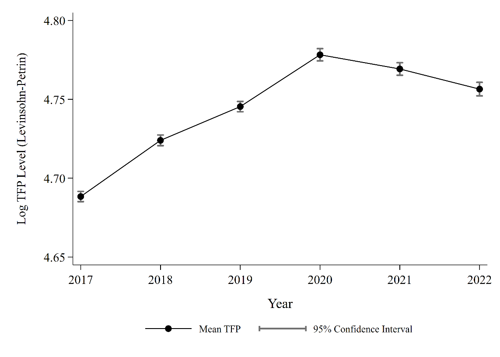
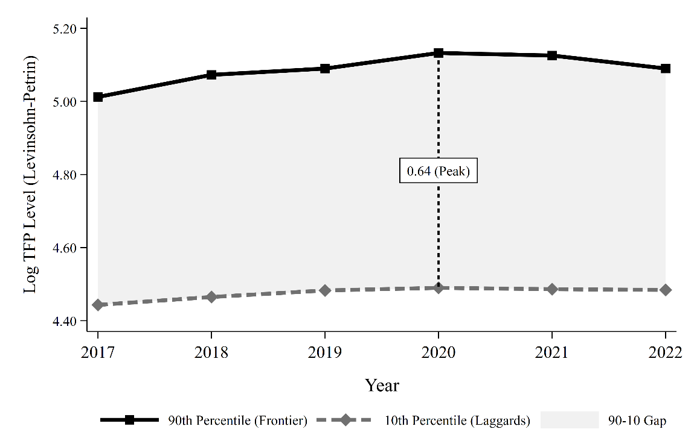
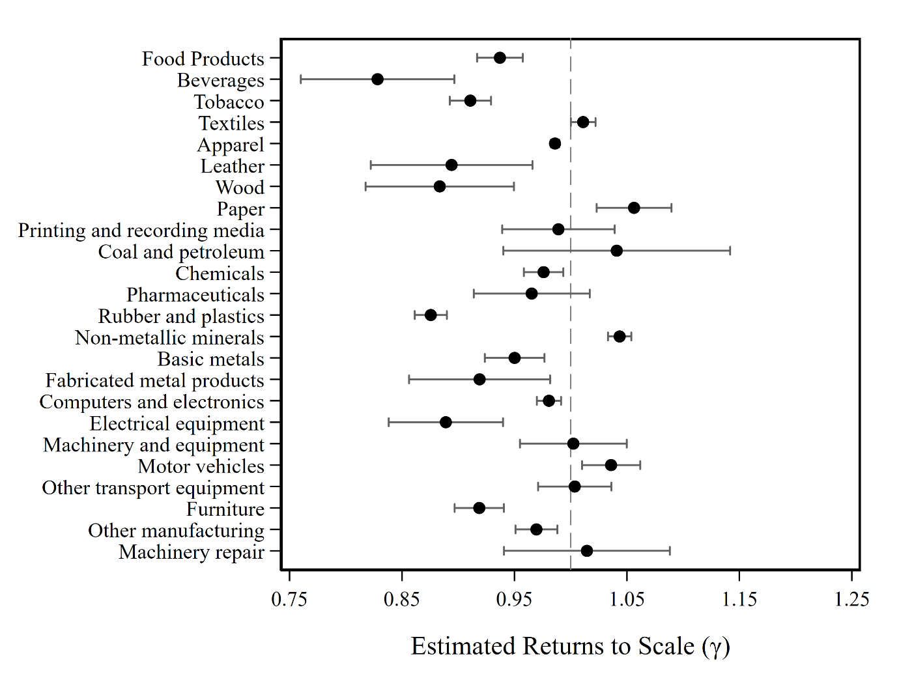
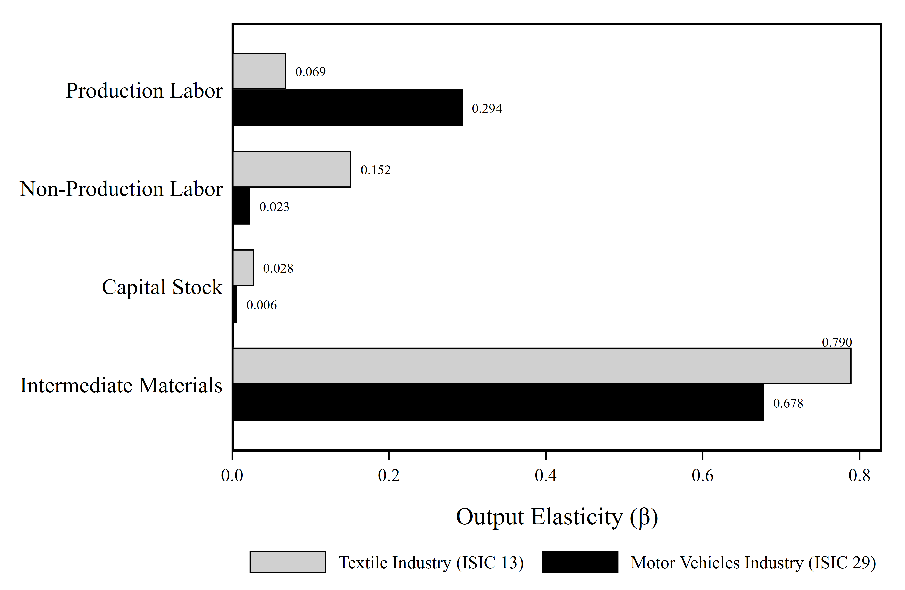

::: {.callout-tip appearance="simple" icon="false"}
**At a glance**

- **Data:** *Industri Besar dan Sedang* (IBS), BPS, 2017–2022 · 148,617 firm-year observations
- **Method:** Levinsohn–Petrin (2003) production function, Stata 18
- **Headline:** materials carry most of the output elasticity (0.685); mean TFP rose to a 2020 peak, and the frontier–laggard gap was widest that year (0.64 log points)
- **Code:** [01 Clean](code/01_clean_ibs2020.do) · [02 Append](code/02_append_panel.do) · [03 TFP & figures](code/03_tfp_and_figures.do)
:::

## Why productivity, and why firms

Industrial policy is back on the agenda. Many developing countries see it as a way to build industrial capacity and drive growth. Firms are where that growth actually happens, and researchers have long studied both how firms shape industrial policy and how they benefit from it.

This project looks at firm-level productivity in Indonesian manufacturing. Productivity is hard to measure directly, so the analysis centers on **Total Factor Productivity (TFP)**, the standard measure of how efficiently a firm turns inputs into output.

The data is the *Industri Besar dan Sedang* survey (Large and Medium Manufacturing, hereafter **IBS**) from Statistics Indonesia, covering 2017 to 2022. Everything runs in Stata 18, end to end. The project doesn't evaluate any specific industrial policy. It's a practical exercise that shows how to:

1. Clean and prepare the dataset, including proper deflation of financial variables.
2. Estimate TFP and its input elasticities.
3. Build descriptive evidence on firm performance and productivity trends.

## Step 1: Cleaning the survey

Each IBS year comes as its own file with year-specific variable names, so cleaning is done one year at a time. Using 2020 as the example, the do-file:

- builds a numeric **firm ID** and the **ISIC 2- and 5-digit** sector codes;
- deflates **output** with the sector-specific producer price index (IHP, 2010 = 100);
- splits **labor** into production and non-production workers and keeps firms with 20 or more workers (the IBS definition of medium and large);
- imputes **capital** where the opening value is missing, first from the year-end value and then, for firms that lease, from rent paid; capital is deflated with the general wholesale price index (IHPB);
- deflates **raw materials** with the IHPB.

The core of the output deflation looks like this:

```{.stata}
* Sector-specific producer price deflator (IHP, 2010 = 100)
gen ihp2020 = .
replace ihp2020 = 150.43 if disic2 == 10
replace ihp2020 = 163.93 if inlist(disic2, 11, 12)
* ... one line per sector group ...

gen real_output = (output / ihp2020) * 100
gen log_output  = ln(real_output)
```

::: {.callout-note collapse="true" icon="false"}
## Full cleaning code for one year (2020)

```{.stata filename="01_clean_ibs2020.do"}

```
:::

The cleaned years are then stacked into one panel and declared with `xtset`:

::: {.callout-note collapse="true" icon="false"}
## Appending 2017–2022 into a panel

```{.stata filename="02_append_panel.do"}

```
:::

## Step 2: What the data looks like

Table 1 summarizes the variables used in the TFP estimation. Output is real (deflated) output, labor is production plus non-production workers, capital is the firm's capital stock, and materials are raw materials used in production. All are in natural logs.

| Variable | Description | Obs | Mean | Std. Dev. | Min | Max |
|:---|:---|---:|---:|---:|---:|---:|
| `log_output` | Real output | 148,617 | 16.453 | 2.096 | 4.795 | 24.980 |
| `log_labor` | Total labor | 148,617 | 4.293 | 1.211 | 0 | 10.920 |
| `log_prodlab` | Production labor | 148,617 | 4.094 | 1.226 | 0 | 10.844 |
| `log_nonprodlab` | Non-production labor | 127,110 | 2.488 | 1.351 | 0 | 9.485 |
| `log_capital` | Capital stock | 148,617 | 14.088 | 2.634 | 1.839 | 26.592 |
| `log_material` | Intermediate materials | 148,617 | 15.670 | 2.290 | 3.423 | 24.704 |

: **Table 1.** Descriptive statistics (all variables in logs) {.striped .hover}

Non-production labor has fewer observations because some firms report no non-production staff, and the log of zero is undefined.

## Step 3: Estimating TFP

The estimation follows Levinsohn and Petrin (2003). It assumes a Cobb–Douglas technology with two kinds of labor, and uses intermediate inputs (raw materials) rather than investment as a proxy for productivity shocks that the firm sees but the econometrician doesn't:

$$
\ln Y_{it} = \beta_1 \ln L^{P}_{it} + \beta_2 \ln L^{NP}_{it} + \beta_3 \ln M_{it} + \beta_4 \ln K_{it} + \omega_{it} + \varepsilon_{it}
$$

Here $i$ and $t$ index firms and years. $Y_{it}$ is output, $L^{P}_{it}$ and $L^{NP}_{it}$ are production and non-production labor, $M_{it}$ is materials and $K_{it}$ is capital. The $\beta$s are output elasticities, $\omega_{it}$ is firm productivity, and $\varepsilon_{it}$ is an idiosyncratic error.

In Stata this is a single `prodest` call, followed by predicting $\omega_{it}$ as each firm's TFP:

```{.stata}
prodest log_output, free(log_prodlab log_nonprodlab) proxy(log_material) ///
    state(log_capital) id(firm_id) t(year) method(lp) fsresiduals(fsr)

lincom log_prodlab + log_nonprodlab + log_capital + log_material      // returns to scale
test   log_prodlab + log_nonprodlab + log_capital + log_material = 1  // CRS test

predict tfp_lp, omega
```

| Input | Elasticity |
|:---|:---:|
| Production labor | 0.121\*\*\* <br>(0.001) |
| Non-production labor | 0.131\*\*\* <br>(0.001) |
| Capital stock | 0.016\*\*\* <br>(0.000) |
| Intermediate materials | 0.685\*\*\* <br>(0.004) |
| **Returns to scale** ($\sum \hat\beta$) | 0.9535 |
| **Wald test for CRS** ($\chi^2$) | 90.04\*\*\* |
| Observations | 126,976 |
| Period | 2017–2022 |

: **Table 2.** Levinsohn–Petrin input elasticities {.striped}

::: {.small}
*Notes:* \*\*\* p<0.01, \*\* p<0.05, \* p<0.10. Standard errors in parentheses. Intermediate materials proxy for unobserved productivity shocks to address simultaneity bias. Returns to scale is the sum of the estimated elasticities. Source: Author's own calculation.
:::

**Materials dominate.** At 0.685, the materials elasticity is several times larger than production labor (0.121), non-production labor (0.131) or capital (0.016). All four are significant at 1%. Returns to scale of 0.9535 point to slightly decreasing returns, and the Wald test rejects constant returns at the 1% level.

This suggests Indonesian manufacturing is material-intensive. Production depends on raw materials and intermediate inputs more than on accumulating capital or adding workers, so how reliably and efficiently firms source and use materials matters a lot for their performance.

::: {.callout-note appearance="simple" icon="false"}
**A garment factory as an example**

Take a factory making shirts for domestic and export markets:

- **Production labor:** sewing operators, cutters, assemblers
- **Non-production labor:** administrators, accountants, supervisors, warehouse managers
- **Capital:** sewing machines, cutting equipment, buildings
- **Materials:** fabric, thread, buttons, zippers, labels, packaging

Even with enough workers and machines, the factory can't produce without fabric. A supply disruption leaves machines idle and workers unable to finish orders. That dependence is what a large materials elasticity captures.
:::

## Step 4: What the TFP estimates show

### Productivity rose until 2020, then slipped

{#fig-level fig-alt="Line chart of mean log TFP from 2017 to 2022, rising from about 4.69 to a peak of about 4.78 in 2020, then easing to about 4.76 by 2022."}

Productivity climbed steadily from 2017 and peaked in 2020, then declined gradually through 2022. The rise continued into the first COVID-19 year, which could reflect firms adjusting how they produce or a change in which firms survived. The later decline suggests those gains didn't fully hold.

::: {.callout-note collapse="true" icon="false"}
## Code for Figure 1

```{.stata}
preserve
collapse (mean) mean_tfp = tfp_lp (sd) sd_tfp = tfp_lp (count) n = tfp_lp, by(year)
gen ci_high = mean_tfp + 1.96 * (sd_tfp / sqrt(n))
gen ci_low  = mean_tfp - 1.96 * (sd_tfp / sqrt(n))

twoway (rcap ci_low ci_high year, lcolor(gs7) lwidth(medthick)) ///
       (connected mean_tfp year, lcolor(black) mcolor(black) msymbol(O) lwidth(thick)), ///
    ytitle("Log TFP Level (Levinsohn-Petrin)") xtitle("Year") ///
    ylabel(4.65(0.05)4.80, angle(0) nogrid format(%9.2f)) xlabel(2017(1)2022, nogrid) ///
    legend(order(2 "Mean TFP" 1 "95% Confidence Interval") rows(1) position(6))
graph export "fig1-tfp-level.png", replace width(3600)
restore
```

Full styling options are in [03_tfp_and_figures.do](code/03_tfp_and_figures.do).
:::

### The average hides a widening gap

{#fig-dispersion fig-alt="Two lines: the 90th percentile of TFP rises from about 5.01 in 2017 to 5.13 in 2020 then dips; the 10th percentile stays nearly flat around 4.45 to 4.49. The gap peaks at 0.64 in 2020."}

Firms at the 90th percentile consistently outperform those at the 10th, and the gap widened from 2017 to a peak of **0.64 log points in 2020**. Frontier firms gained until 2020 while laggards improved only modestly. After 2020, frontier productivity started to fall and laggards stayed flat.

So productivity growth in Indonesian manufacturing was uneven. Leading firms drove most of it, rather than improvements spreading across the sector.

::: {.callout-note collapse="true" icon="false"}
## Code for Figure 2

```{.stata}
preserve
collapse (p90) p90_tfp = tfp_lp (p10) p10_tfp = tfp_lp, by(year)

quietly summarize p90_tfp if year == 2020
local y90 = r(mean)
quietly summarize p10_tfp if year == 2020
local y10 = r(mean)
local gap_str : display %9.2f `y90' - `y10'
local gap_str = trim("`gap_str'")
local ymid = (`y90' + `y10') / 2

twoway (rarea p90_tfp p10_tfp year, fcolor(gs12) lcolor(none)) ///
       (connected p90_tfp year, lcolor(black) msymbol(S) lwidth(thick)) ///
       (connected p10_tfp year, lcolor(gs7) msymbol(D) lpattern(dash) lwidth(thick)) ///
       (scatteri `y90' 2020 `y10' 2020, connect(line) msymbol(none) lpattern(shortdash)), ///
    text(`ymid' 2020 "`gap_str' (Peak)", box fcolor(white)) ///
    legend(order(2 "90th Percentile (Frontier)" 3 "10th Percentile (Laggards)" 1 "90-10 Gap") ///
        rows(1) position(6))
graph export "fig2-dispersion.png", replace width(4000)
restore
```

Full styling options are in [03_tfp_and_figures.do](code/03_tfp_and_figures.do).
:::

### Returns to scale differ by sector

{#fig-rts fig-alt="Dot-and-whisker chart of returns to scale for 24 two-digit manufacturing sectors, ranging from about 0.83 for beverages to about 1.06 for paper."}

Re-estimating the production function sector by sector shows a lot of variation. Several industries sit near constant returns. Paper, non-metallic minerals and motor vehicles come out above one, suggesting increasing returns. Beverages, leather, rubber and plastics, and electrical equipment come out well below one.

The takeaway is that manufacturing doesn't share a single production structure. How much a firm gains from scaling up depends on its subsector.

::: {.callout-note collapse="true" icon="false"}
## Code for Figure 3

The loop runs `prodest` for each 2-digit sector, then stores the coefficients, the returns to scale and a test of constant returns with `postfile`:

```{.stata}
levelsof disic2, local(sectors)
tempname results
tempfile sector_results
postfile `results' int disic2 double rts rts_se p_crs long N ///
    using `sector_results', replace

foreach s of local sectors {
    capture drop fsr
    capture quietly prodest log_output if disic2 == `s', ///
        free(log_prodlab log_nonprodlab) proxy(log_material) ///
        state(log_capital) id(firm_id) t(year) method(lp) fsresiduals(fsr)
    if !_rc {
        quietly lincom log_prodlab + log_nonprodlab + log_capital + log_material
        local rts = r(estimate)
        local se  = r(se)
        quietly test log_prodlab + log_nonprodlab + log_capital + log_material = 1
        post `results' (`s') (`rts') (`se') (r(p)) (e(N))
    }
}
postclose `results'

use `sector_results', clear
gen ci_low  = rts - 1.96*rts_se
gen ci_high = rts + 1.96*rts_se

twoway (rcap ci_low ci_high disic2, horizontal lcolor(gs6)) ///
       (scatter disic2 rts, mcolor(black) msymbol(O)), ///
    xline(1, lpattern(dash)) yscale(reverse) ylabel(10(1)33, valuelabel angle(0)) ///
    xtitle("Estimated Returns to Scale ({&gamma})") ytitle("") legend(off)
graph export "fig3-sectoral-rts.png", replace width(3000)
```

The sector labels and full styling options are in [03_tfp_and_figures.do](code/03_tfp_and_figures.do).
:::

### Two sectors, two production structures

{#fig-two-sectors fig-alt="Grouped horizontal bar chart comparing textiles and motor vehicles. Production labor 0.069 vs 0.294; non-production labor 0.152 vs 0.023; capital 0.025 vs 0.009; materials 0.792 vs 0.685."}

Finally, the comparison of **textiles (ISIC 13)** and **motor vehicles (ISIC 29)** asks whether the material-intensity story holds in sectors that look very different.

Materials are still the largest elasticity in both (0.792 for textiles and 0.685 for motor vehicles), but the labor structures diverge:

- **Production labor** matters far more in motor vehicles (0.294) than in textiles (0.069).
- **Non-production labor** is higher in textiles (0.152) than in motor vehicles (0.023).
- **Capital** contributes little in either sector.

Textiles look especially material-intensive, while motor vehicles lean more on direct production workers. In both cases, material inputs remain central.

::: {.callout-note collapse="true" icon="false"}
## Code for Figure 4

```{.stata}
foreach s in 13 29 {
    if `s' == 13 local sname = "Textile Industry"
    if `s' == 29 local sname = "Motor Vehicles Industry"
    capture drop fsr
    capture quietly prodest log_output if disic2 == `s', ///
        free(log_prodlab log_nonprodlab) proxy(log_material) ///
        state(log_capital) id(firm_id) t(year) method(lp) fsresiduals(fsr)
    if !_rc post `results' (`s') ("`sname'") (_b[log_prodlab]) ///
        (_b[log_nonprodlab]) (_b[log_capital]) (_b[log_material])
}
* ... reshape long, then:
graph hbar (mean) elasticity, over(sector_name) over(input_id) asyvars ///
    blabel(bar, format(%9.3f)) ytitle("Output Elasticity ({&beta})") ///
    legend(order(1 "Textile Industry (ISIC 13)" 2 "Motor Vehicles Industry (ISIC 29)"))
graph export "fig4-elasticities-two-sectors.png", replace width(3600)
```

The complete loop, reshape and styling are in [03_tfp_and_figures.do](code/03_tfp_and_figures.do).
:::

## What this adds up to

Using IBS data for 2017–2022 and the Levinsohn–Petrin approach, the project estimates firm-level TFP and describes several features of manufacturing performance:

- **Materials carry the most weight** in production, which points to the material-intensive nature of Indonesian manufacturing.
- **Average TFP rose until 2020** and then declined gradually through 2022.
- **The average hides a gap.** Frontier firms pulled away from laggards, and the gap peaked in 2020.
- **Production structures differ by sector**, in both returns to scale and input elasticities.

Taken together, strengthening manufacturing capacity is about more than adding inputs. It's also about how well firms combine and use them. For a developing economy like Indonesia, understanding sector-specific production structures, improving access to intermediate inputs and narrowing the gap between leading and lagging firms are useful starting points for industrial policy discussions.

This is descriptive work. It doesn't establish causal links between industrial policy and productivity, but it shows what firm-level productivity analysis can reveal about structure and performance in the manufacturing sector.

## Replicate it

| Step | File | What it does |
|:---|:---|:---|
| 1 | [01_clean_ibs2020.do](code/01_clean_ibs2020.do) | Cleans and deflates one survey year; repeat for each year with that year's variable suffixes and deflators |
| 2 | [02_append_panel.do](code/02_append_panel.do) | Stacks 2017–2022 and declares the panel |
| 3 | [03_tfp_and_figures.do](code/03_tfp_and_figures.do) | Table 1, the Levinsohn–Petrin estimation (Table 2), and Figures 1–4 |

: {.striped}

Requires Stata 18 (earlier versions should work) and the `prodest` package (`ssc install prodest`). The IBS microdata is distributed by BPS–Statistics Indonesia and isn't included here.

**Reference:** Levinsohn, J., & Petrin, A. (2003). Estimating production functions using inputs to control for unobservables. *The Review of Economic Studies*, 70(2), 317–341.
